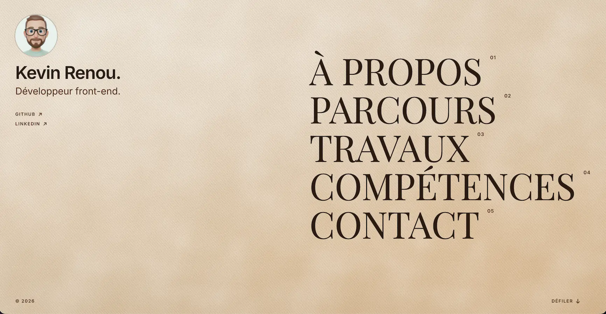
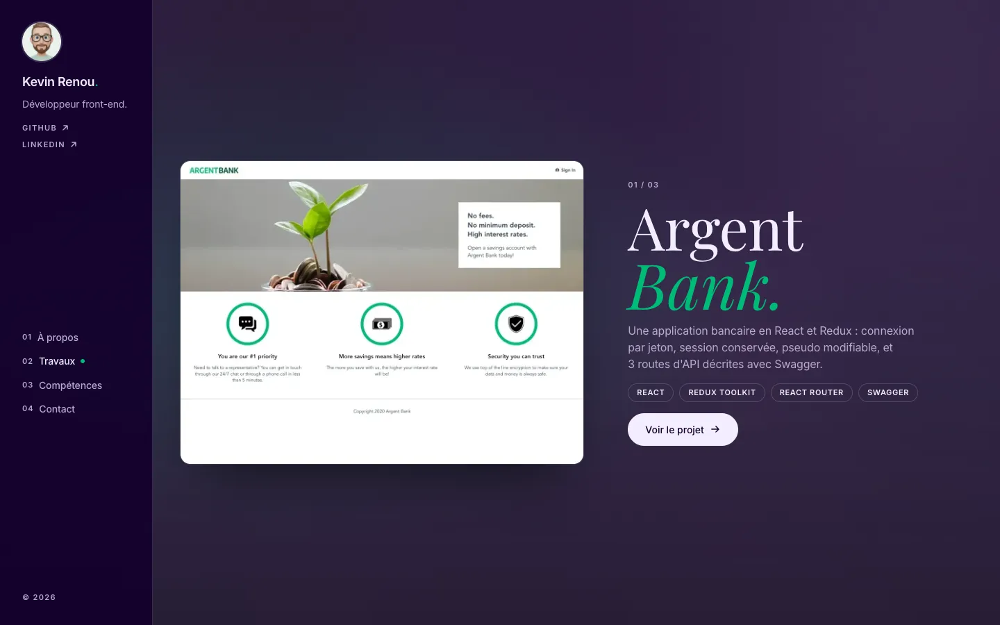

# Portfolio — Kevin Renou

Portfolio de **développeur front-end React**, conçu et codé de zéro : une seule page, découpée en huit « pièces » plein écran, avec trois projets phares et un site réalisé pour un client.

## Liens

- **Site en ligne** : [tournetmarou.netlify.app]
- **Code du portfolio** : ce dépôt, [github.com/KevinPTEK/portfolio](https://github.com/KevinPTEK/portfolio).
- **Me retrouver** : [GitHub](https://github.com/KevinPTEK) · [LinkedIn](https://www.linkedin.com/in/kevin-renou).

Les projets présentés :

| Projet        | Ce que j'y ai fait                                                                       | Liens                                                                                                                      |
| ------------- | ---------------------------------------------------------------------------------------- | -------------------------------------------------------------------------------------------------------------------------- |
| Argent Bank   | Une application bancaire en React et Redux : connexion par jeton, profil, API documentée | [code d'Argent Bank](https://github.com/KevinPTEK/ArgentBank)                                                              |
| 724events     | Le débogage d'un site React : bugs corrigés, tests remis au vert, cahier de recette      | [code de 724events](https://github.com/KevinPTEK/724events-debug)                                                          |
| Nina Carducci | L'optimisation du site d'une photographe : performances, accessibilité, référencement    | [site de Nina Carducci](https://kevinptek.github.io/ninacarducci/) · [son code](https://github.com/KevinPTEK/ninacarducci) |
| Tourn&Marou   | L'intégration du site vitrine d'un réparateur de vélos, en HTML, Sass et JavaScript      | [site de Tourn&Marou](https://tournetmarou.netlify.app/) (code privé : il appartient au client)                            |

## Stack technique

| Rôle                    | Outil                                                                                                  |
| ----------------------- | ------------------------------------------------------------------------------------------------------ |
| Outillage et build      | [Vite 8](https://vite.dev) (bundler Rolldown)                                                          |
| Interface               | [React 19](https://react.dev), JavaScript ES2022+                                                      |
| Styles                  | [Dart Sass](https://sass-lang.com) (modules `@use`), méthodologie BEM                                  |
| Animations              | [Motion](https://motion.dev) chargé à la demande, Web Animations (`ScrollTimeline`), canvas, CSS natif |
| Tests                   | [Vitest](https://vitest.dev), [Testing Library](https://testing-library.com), happy-dom                |
| Qualité                 | ESLint, Prettier                                                                                       |
| Gestionnaire de paquets | [pnpm](https://pnpm.io)                                                                                |

## Aperçu





## Le concept

Le site se lit comme une feuille de papier. L'accueil, les autres réalisations et le contact sont sur papier kraft, « À propos » et « Compétences » sur un papier blanc bleuté, et les trois projets sont les seules pièces colorées : la couleur de la page suit la pièce que l'on regarde. À l'arrivée sur le site, un sceau « KR » se dessine puis une brume se lève ; on arrive sur un menu typographique géant, et un clic fait défiler jusqu'à la pièce visée.

Chaque projet ouvre une fiche : le contexte, les problèmes rencontrés, ce que j'en ai appris, les technologies, et les liens vers le code et, quand il est en ligne, vers le site.

## Choix techniques

- **Vite + React plutôt qu'un framework** : une page unique et statique, sans routage ni serveur — le cas où la documentation de React recommande de partir de Vite.
- **Composants réutilisables** : un composant ne connaît rien du site ; tout passe par ses props et par le design system. Les sections assemblent composants et données.
- **Contenu dans des fichiers JSON** : ajouter un projet ne demande que des données — son entrée JSON, ses captures et, s'il a ses propres couleurs, un thème Sass.
- **Le natif d'abord** : la modale est un `<dialog>` natif (gestion du focus, touche Échap, fond) — aucune bibliothèque de modale.
- **Sass moderne** : modules `@use` / `@forward` uniquement (`@import` est déprécié) ; un design system en trois niveaux — outils sans sortie CSS, styles globaux, et styles de chaque composant rangés avec lui.
- **Mobile-first** : les styles de base sont ceux du mobile ; deux points de rupture (640 px, 1024 px) ajoutent des colonnes.
- **Des animations qui ne retardent pas l'affichage** : les fonctions d'animation de Motion arrivent après le premier affichage (`LazyMotion`) ; l'avatar qui vole jusqu'à la navigation suit le défilement grâce à une `ScrollTimeline`, pilotée par le navigateur (avec un repli en JavaScript là où elle manque) ; la brume de l'intro est un canvas chargé à part.
- **Images responsives** : chaque capture existe en 600, 900 et 1 200 px de large ; le navigateur choisit la bonne (`srcset`, `sizes="auto"` avec une liste de repli), et la place est réservée au format 4:3, sans décalage de la mise en page.

## Accessibilité et sobriété

- **Accessibilité — objectif WCAG 2.1 AA** (équivalent RGAA 4) : HTML sémantique, navigation complète au clavier, focus visible, contrastes vérifiés pièce par pièce, `prefers-reduced-motion` respecté (pas d'intro, mouvements coupés, défilement instantané ; seuls de simples fondus restent).
- **Green code** : site statique, JavaScript limité et chargé à la demande (budget : 100 Ko compressés pour le premier affichage), animations surtout sur `transform` et `opacity`, intro jouée une fois par onglet, polices auto-hébergées, images WebP en trois tailles chargées en différé, aucun traqueur.
- Les mesures Lighthouse et EcoIndex seront publiées ici à la livraison.

## Démarrer

Prérequis : Node.js 22 (22.13 ou plus), 24 ou 26+ — les versions que demandent Vitest et ESLint —, et pnpm.

```bash
git clone https://github.com/KevinPTEK/portfolio.git
cd portfolio
pnpm install
pnpm dev
```

| Script              | Rôle                                   |
| ------------------- | -------------------------------------- |
| `pnpm dev`          | serveur de développement               |
| `pnpm build`        | version de production dans `dist/`     |
| `pnpm preview`      | sert la version de production en local |
| `pnpm lint`         | analyse du code avec ESLint            |
| `pnpm format`       | met le code en forme avec Prettier     |
| `pnpm format:check` | vérifie la mise en forme, sans écrire  |
| `pnpm test`         | tests, relancés à chaque sauvegarde    |
| `pnpm test:run`     | tests en un seul passage               |

## Structure

```text
src/
  components/   composants d'interface réutilisables (un dossier par composant, avec ses tests)
  sections/     les pièces du site, qui assemblent composants et données
  animations/   tout ce qui bouge : intro, avatar volant, apparitions, défilement, thème courant
  hooks/        hooks React partagés
  data/         le contenu en JSON : projets, sites, compétences, profil, menu, réseaux
  styles/       design system Sass (abstracts : outils · base : styles globaux)
  assets/       le portrait : ses versions WebP, importées par le code, et sa source
  utils/        petites fonctions partagées
  testing/      aides pour les tests
public/
  images/       captures des projets, en trois tailles, lues depuis les données
```

Règle de dépendance : `sections/` importe `components/`, `animations/` et `data/` — jamais l'inverse. C'est ce qui garde les composants réutilisables.

## Ajouter un projet

1. **Ses données** : une entrée dans `src/data/projects.json` (pour un site vitrine : `sites.json`). Les règles — champs remplis, liens en `https://`, titre et accent — sont vérifiées par `projects.test.js` et `sites.test.js`.
2. **Ses captures**, en WebP au format 4:3, dans `public/images/` : l'originale de 1 200 × 900 px, ses versions de 600 et 900 px de large (`…-600.webp`, `…-900.webp`) et, pour un projet phare, une version floutée (`…-blur.webp`, 4 Ko au plus). `images.test.js` échoue s'il en manque une, si une image dépasse son poids, ou si une capture n'a pas la largeur et la hauteur annoncées. Les miennes sont réduites et encodées dans Chrome ; le test lit les dimensions dans l'en-tête que Chrome écrit (VP8X), et dit clairement s'il ne sait pas lire celui d'un autre outil.
3. **Ses couleurs**, pour un projet phare qui a les siennes : un thème dans `src/styles/abstracts/_themes.scss` (son nom est vérifié par `projects.test.js`).

Puis `pnpm test:run` : tout est vérifié d'un coup.

## Démarche

Le site a été conçu avant d'être codé : charte graphique, maquette interactive, puis spécification technique (stack, composants, accessibilité, budget de performance) — des documents de travail hors de ce dépôt, présentés en soutenance. Chaque morceau suit le même cycle : un test qui échoue, le code qui le fait passer, une revue, puis des mesures dans un vrai navigateur. Les tests cherchent les éléments comme le ferait un utilisateur, par leur rôle et leur nom accessible : un test qui passe est aussi un contrôle d'accessibilité. Des « mutants » (des valeurs volontairement faussées) vérifient que les tests attrapent bien les erreurs.

## Avancement

- [x] Initialisation : Vite, React, Sass, Motion, Vitest
- [x] Design system Sass et métadonnées SEO
- [x] Composants d'interface, testés
- [x] Sections et données : site complet, responsive et accessible
- [x] Animations
- [x] Contenus définitifs et images optimisées
- [x] Mesures (Lighthouse, EcoIndex, clavier, VoiceOver) et déploiement

---

Projet 12 du parcours **Développeur web** d'OpenClassrooms · [Kevin Renou sur GitHub](https://github.com/KevinPTEK)
